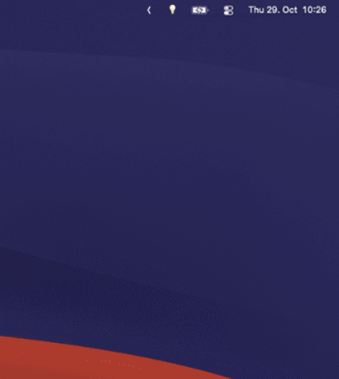

# KeylightBar 💡

**[Webpage](https://keylightbar.cedricscherer.com/) · [Releases](https://github.com/z3tt/keylightbar/releases)**

<p align="left">
  <a href="https://github.com/z3tt/keylightbar/actions/workflows/build.yml"></a>
</p>

Control any [Elgato Key Light](https://www.elgato.com/key-light) in your macOS menu bar — one click to switch it on, and from there it manages itself: it turns off when your Mac sleeps, comes back on when you wake it, and moves between your daytime and evening setups on schedule.

<p align="center">
  
  <br>
  <b>🌑 turns the light on. 💡 opens the preset menu.</b><br/>
  No Dock icon, no companion windows, no dependencies.
</p>

## How to install the app

1. Download **KeylightBar.zip** from the [Releases page](https://github.com/z3tt/keylightbar/releases) and unzip it.
2. Try to open **KeylightBar.app** once (macOS will block it), then go to **System Settings → Privacy & Security**, scroll down, and click **Open Anyway**. The app is unsigned, so Gatekeeper needs that one-time approval; macOS remembers it afterwards. On older macOS versions, right-click **KeylightBar.app** → **Open** → **Open** works too.
3. There's your 💡 in the menu bar. If macOS asks for **Local Network** access, say yes — without it, KeylightBar can't reach your light.

To start it automatically at login, flip **Start At Login** in the 💡 menu — KeylightBar registers itself as a macOS Login Item.

## What you get

A single icon to control your Key Light — simple, but versatile thanks to its two states:

| State               | Action                                                      |
| ------------------- | ----------------------------------------------------------- |
| 🌑 light is **off** | Click turns it **on** with the last-used preset             |
| 💡 light is **on**  | Click opens the **preset menu** to choose predefined setups |

### Additional features

- **Your presets, built in-app.** Seven sensible presets ship with it — _Work, Meet, Night, Chill, Bright, Cold, Warm_ — and you can add, rename, and tune your own with sliders. No config files, no command line.
- **A light that sleeps and wakes with your Mac.** Two independent rules you can toggle: _Off When Mac Sleeps_ and _On When Mac Wakes_. This is the gap KeylightBar was born to fill — Elgato's own Control Center can switch your light off automatically, but nothing switches it back on when you return to your desk.
- **A light that knows the time.** _Time Of Day_ switches between a day preset and an evening preset automatically — Work until 19:00, Chill after (presets and hours are yours to choose). It applies on its own while you work, and on wake.
- **Always in sync.** The icon and menu reflect the light's _real_ state — even if you changed it from Elgato's app or the physical controls, KeylightBar keeps up.
- **Zero setup on normal networks.** It finds your light by itself; on networks where auto-discovery fails, it scans the local network and finds it anyway. And it never pretends to control what it can't reach: preset picking stays disabled until your light is actually connected.
- **Tiny and private.** One Swift file, no dependencies, and it talks only to your light over your local network.

## Compatibility

KeylightBar works with all Elgato WiFi lights — **Key Light, Key Light Air, Key Light Mini, Ring Light, and Light Strip** — because they all speak the same local API. On the RGB **Light Strip**, the temperature value has no visible effect (brightness and on/off work as expected).

Note that macOS grants **Local Network** access per binary: a freshly compiled KeylightBar needs its own permission, even if a previous build had one. If commands silently do nothing, check _System Settings → Privacy & Security → Local Network_ and enable KeylightBar there.

## Make it yours

Everything is adjustable right from the 💡 menu — no source editing, no terminal.

- **Presets** — _Manage Presets…_ opens a small editor: pick a preset in the table (or double-click its name to rename it), then set name, brightness (0–100), and temperature (143 = coldest, 344 = warmest) with the sliders. _+ Add_ asks for a name right away and starts from the selected preset's settings. Names are always title-cased (e.g. "Night Mode"). Changes apply immediately and survive restarts; _Reset Defaults_ restores the original seven.
- **Sleep & Wake** — the _Off When Mac Sleeps_ / _On When Mac Wakes_ checkboxes. On wake, KeylightBar applies the time-appropriate preset if _Time Of Day_ is on, otherwise your last-used one.
- **Time Of Day** — the _Switch Presets By Time_ toggle plus day/evening presets and the hours they start (defaults: Work from 08:00, Chill from 19:00).
- **Start At Login** — one checkbox in the 💡 menu; no fiddling in System Settings.

## Build it yourself

Requirements: a Mac with the Swift toolchain (ships with Xcode Command Line Tools: `xcode-select --install`).

```sh
make bundle        # compiles the app and (re)builds KeylightBar.app
open KeylightBar.app
```

## For tinkerers

Two things still live in the configuration block at the top of `main.swift` (edit and rebuild):

```swift
let pollInterval: TimeInterval = 5       // state sync every N seconds

let iconOn  = "💡"                       // menubar icon while on
let iconOff = "🌑"                       // menubar icon while off
```

If a configured preset no longer exists (renamed or removed in the manager), the time switch falls back to the first preset in the list.

## Troubleshooting

- **macOS offers only "Move to Bin"** → Gatekeeper blocking the unsigned app. Approve it via **System Settings → Privacy & Security → Open Anyway**, or clear the quarantine flag before launching: `xattr -d com.apple.quarantine KeylightBar.app`. Only a notarized build would avoid the prompt entirely (see #3).
- **Nothing happens on click** → check Local Network permission (see above), and that the Mac and Key Light are on the same network.
- **Icon shows 🌑 although the light is on** → the launch sync couldn't reach the light. Most common cause: a freshly compiled binary hasn't been granted _Local Network_ access yet — approve it and the icon corrects itself within seconds (the app retries shortly after launch). If it stays wrong for over a minute, check the address via _Configure…_.
- **Light doesn't turn on after wake** → right after wake, the Mac's network often isn't up yet. KeylightBar checks the light's real state and retries for about 20 seconds, so it turns on as soon as the network is back — no action needed. If it never comes on, check Local Network permission and the address via _Configure…_.
- **Discovery doesn't find the light** → _Find Key Light_ searches twice: via Bonjour and via a scan of your local network. If both fail, the light likely isn't reachable at all — use _Configure…_ and enter `IP:9123` directly.
- **Compile warnings about NetService deprecation** → expected and accepted; the API works fine and keeps the app single-file. Migrating to `NWBrowser` (Network.framework) is the modern alternative.

## Contributing

Issues and pull requests are welcome! This is a hobby project, so kindness beats formality.

- **Start small.** One logical change per PR. If you're unsure or it's more than that, open an issue first so we can talk it through.
- **Build before you push.** `make bundle` must compile clean (`swiftc main.swift` → 0 errors). The `NetService` deprecation warning is expected and accepted.
- **Respect the constraints.** KeylightBar is a single Swift file with zero dependencies by design; please adhere to this principle. The absence of a Dock icon or companion windows is intentional.
- **Test against a real light** if you can. Network behavior is hard to fake: a change that compiles is not necessarily a change that works.
- **Website changes** live in `docs/`. Edit just `scss/main.scss`. Changes made to the `.css` file will be overwritten, as GitHub Actions compiles `css/main.css` from the `.scss` file and commits the file on push (`.github/workflows/site-styles.yml`), so there's no local build step and nothing extra to commit.

Version tags and releases stay with the maintainer.

## Trademark notice

KeylightBar is an independent, open-source project. It is not affiliated with, endorsed by, or connected to Elgato or Corsair. _Elgato_, _Key Light_, and related names are trademarks of Corsair Memory, Inc., used here solely to state that KeylightBar works with their lights.

## License

[MIT](LICENSE) — [Cédric Scherer](https://cedricscherer.com)
